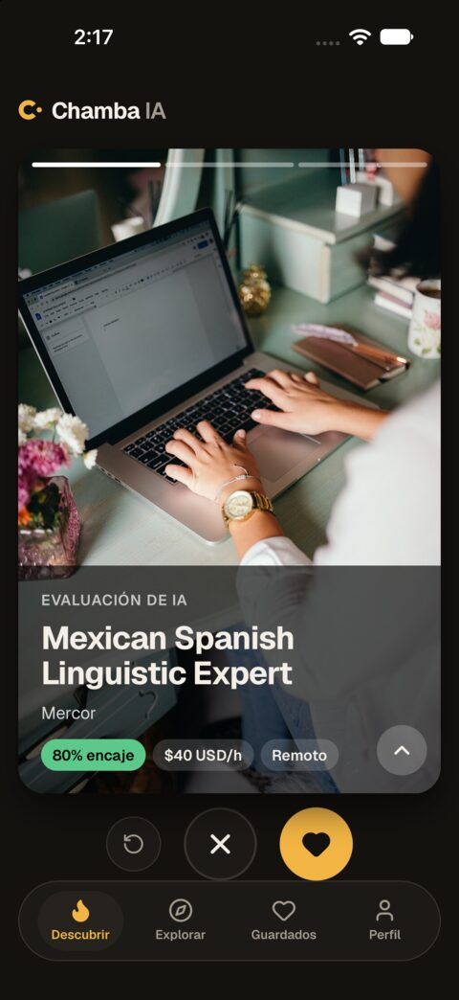
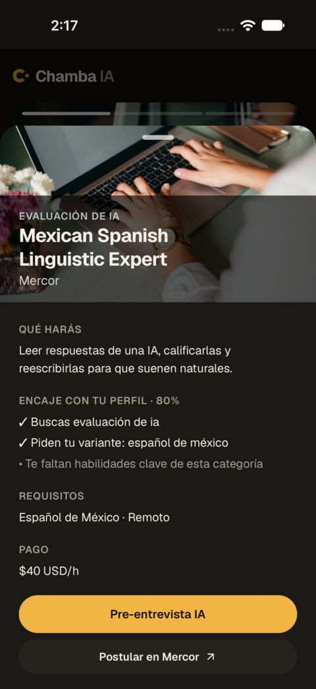
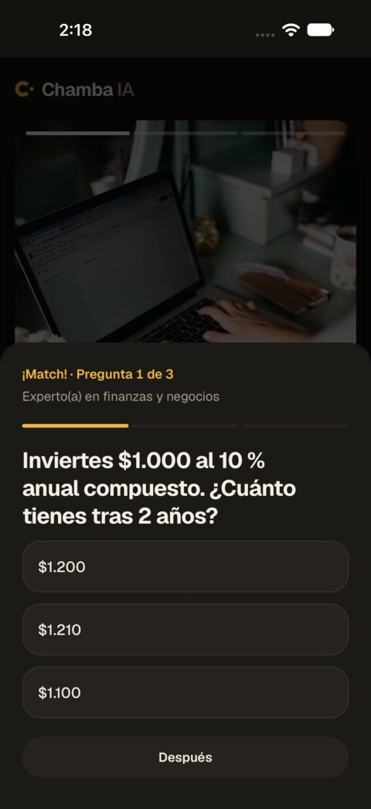
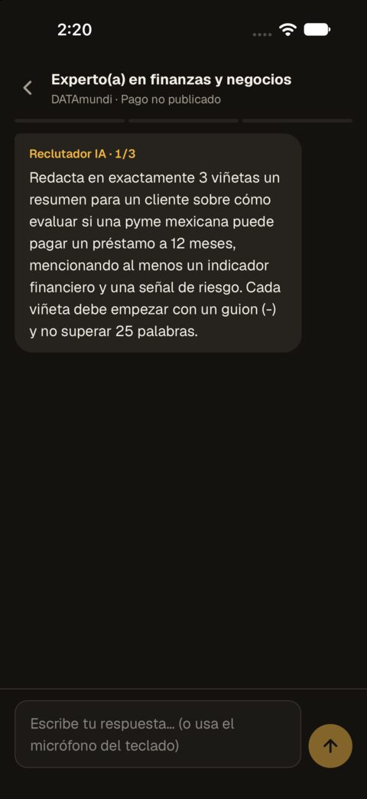
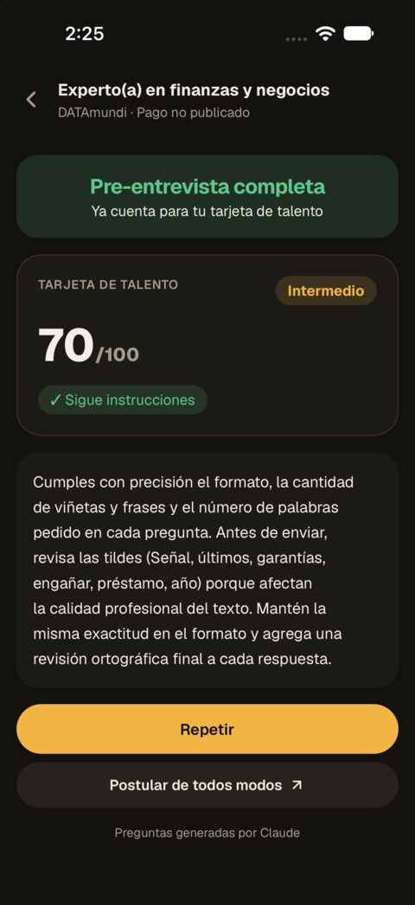
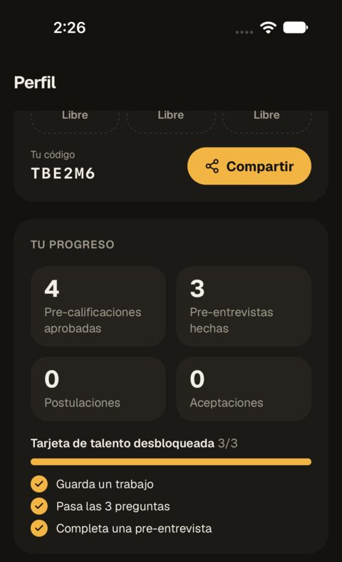
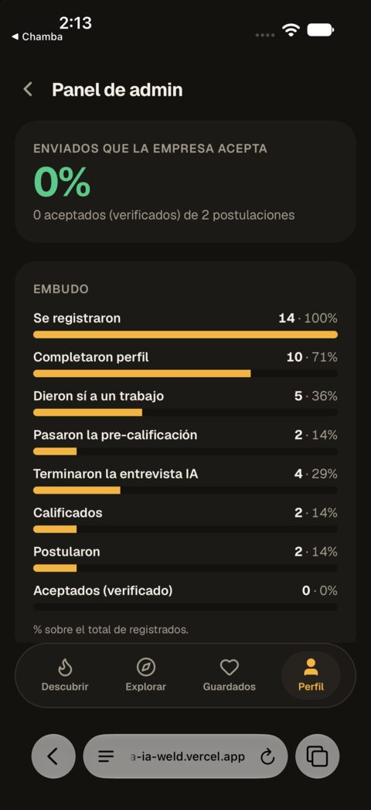
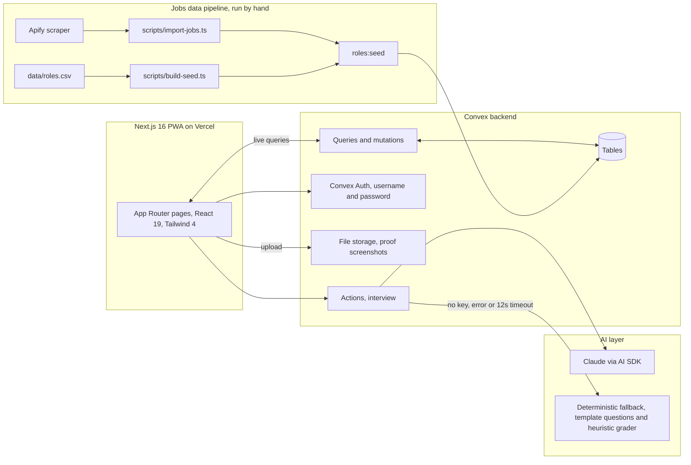
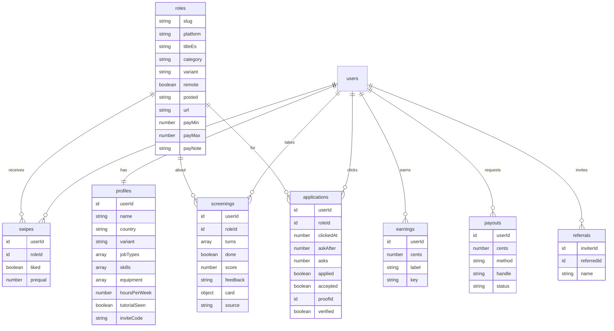
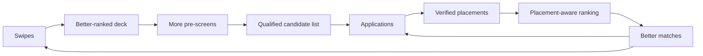

# Chamba IA

**A Spanish-language phone app that matches Latin American Spanish speakers with AI-training work (voice, transcription, evaluation, expert review) and pre-screens them before they apply.**

- Live app: https://chamba-ia-weld.vercel.app
- Demo video: [10-minute walkthrough](https://youtu.be/P8wMTRsDoGQ)

## Why this exists

AI labs need native Spanish testers for voice data, transcription, response evaluation and expert review, and Latin America has millions of capable people who never see these jobs. The jobs are scattered across platforms, usually posted in English, and give no feedback on whether you would fit.

Chamba IA puts them in one Spanish deck, ranks them by how well each one fits you, and pre-screens you before you apply. Workers apply with more confidence, and labs get a list of candidates who have already shown their Spanish. I care about this because LATAM talent is one of the biggest untapped pools for AI work, and the gap between the two is mostly information.

The app UI is Spanish. This README is in English.

## What a user can do

| Step | Screen | What happens |
| ---- | ------ | ------------ |
| 1 | `/` landing | Pitch, job categories, sign-in call to action |
| 2 | `/entrar` | Username and password sign-up (Convex Auth) |
| 3 | `/onboarding` | Country, Spanish variant, specialties, skills, equipment, hours per week |
| 4 | `/instalar` | Install as a home-screen app (iOS share sheet steps, Android install button) |
| 5 | `/descubrir` | Swipe deck: right to save, left to pass. Each card shows a fit score with its reasons and gaps |
| 6 | prequal modal | A match opens 3 multiple-choice domain questions, graded on the server |
| 7 | `/guardados` | Saved roles |
| 8 | `/entrevista/[roleId]` | 3-question free-text interview. AI writes the follow-ups and grades the answers |
| 9 | talent card | Level, per-skill scores, strengths, a quote as evidence, other categories you also qualify for |
| 10 | Apply | "Postular" opens the original posting and records the click |
| 11 | Follow-up | "¿Postulaste?" then "¿Te aceptaron?", then a screenshot as proof of the offer |
| 12 | `/perfil` | "Tu progreso" (pre-screens passed, interviews, applications, acceptances, steps to the talent card), invite code, "Tu algoritmo" panel |
| - | `/explorar` | Browse by category, including categories the deck has hidden |

**Operator side (`/talento`):** aggregate pool stats (testers, hours, countries, skills), placement stats, the verified-candidate list (proven placements first) and the proof-screenshot review queue. Operator access is an allow-list of user IDs in the `OPERATOR_USER_IDS` Convex env var; everyone else gets aggregates only.

### Screens (iPhone, installed as a home-screen app)

| Install | Swipe deck | Fit score | Pre-screen |
| --- | --- | --- | --- |
|  |  |  |  |
| **AI interview** | **Talent card** | **Progress** | **Admin funnel** |
|  |  |  |  |

## Architecture



Every number shown to a user (fit, rank, rubric total, rewards) is computed in code. The model writes interview questions and judges two writing dimensions; if it is missing, slow or fails, the interview continues on templates and a heuristic grader, so the app works with no key at all.

### Data model

Real fields from `convex/schema.ts` (Convex adds `_id` and `_creationTime`).



## The algorithms

All pure functions in `convex/lib/`, covered by `tests/`.

### Fit score (`convex/lib/fit.ts`)

0 to 100, and every point comes with a Spanish reason or gap shown on the card.

| Signal | Points |
| ------ | ------ |
| Role category is one of your specialties | 40 (20 if you picked none) |
| Spanish variant: exact match / role accepts general or LATAM Spanish | 30 / 20 |
| Key skills for the category | `round(matched / wanted * 20)` |
| Microphone, for voice and transcription roles (other roles get it free) | 10 |

### Deck rank (`convex/roles.ts`)

```
rank = fit + affinity[category] + placementBoost[category] + rateBoost(role) - freshnessPenalty(age)
ties: higher payMax first; postings older than 180 days sink below every fresher one
```

- **Affinity, swipes teach the deck** (`convex/lib/affinity.ts`): `clamp(6 * likes - 8 * passes, -30, +30)` per category. When passes exceed likes by 3 or more, the category is hidden from the main deck (still visible in Explorar), and a toast tells the user. Passes weigh more than likes on purpose.
- **Your placements** (`convex/lib/outcomes.ts`, `placementBoost`): +10 to a category where you have a verified placement, +3 while it is self-reported and awaiting review, 0 if the screenshot was rejected. This only changes your own deck.
- **Freshness** (`convex/lib/freshness.ts`): full rank for 60 days, then a penalty rising to 40 points at 180 days. Older postings sort below all fresher ones, so stale jobs never top the deck.
- **Others' placements** (`rateBoost`): Laplace-smoothed acceptance rate per role, `(accepted + 1) / (applied + 2)`. Zero at or below 0.5, rising linearly to a cap of +5. Only confirmed applications and **operator-verified** placements count, so a self-reported "yes" cannot lift a role for everyone.

### Interview rubric (`convex/lib/rubric.ts`)

| Dimension | Weight | Graded by |
| --------- | ------ | --------- |
| `instrucciones`: followed the stated constraint | 0.30 | Claude (or heuristic) on free text |
| `espanol`: spelling, accents, grammar, naturalness | 0.25 | Claude (or heuristic) on free text |
| `conocimiento`: domain knowledge and detail | 0.45 | Multiple-choice pre-qualifier, `correct / 3 * 100` |

- **Overall** is the weighted mean over the dimensions present, renormalized when the pre-qualifier was skipped. The model is told not to compute a total; code does.
- **QUALIFY_BAR = 72**: the threshold behind "you also fit N more jobs". Example: transcription needs `espanol` and `conocimiento` at 72+; evaluation needs `instrucciones` and `espanol`; voice needs `espanol` and a microphone. A missing dimension never qualifies.
- **Strengths** are dimensions at 70 or above. Without the AI, the level is Avanzado at 80+, Intermedio at 50+.

### Effort gate (`convex/lib/effort.ts`)

- An answer under **MIN_WORDS = 8** words, or with fewer sentences than the question asks for ("en exactamente 2 frases"), is bounced back with an inline message before any AI call.
- An interview counts as complete ("Pre-entrevista completa") only when the overall score and the written answers alone are each **at least 40** (`PAYOUT_MIN_SCORE`); below that the worker is asked to improve and repeat.

### Job import filter (`convex/lib/importJobs.ts`)

Turns a raw scrape of AI-training jobs into deck rows, deterministically, with a drop count per reason.

1. **Spanish**: title mentions Spanish, español or LATAM, or the description asks for fluent, native or proficient Spanish.
2. **AI work only**: drops salaried (yearly pay), recruiter and customer-support postings.
3. **Spain-only and US-only** are dropped, but a LATAM country in the location or eligibility list wins over a stray US or Spain entry.
4. **LATAM-takeable**: a LATAM place, or remote, worldwide or no location.
5. **Duplicates**: same platform and normalized title keeps the first.
6. **Near-duplicates**: same platform, category, variant and published pay collapse to the earliest posting. Roles with no published pay are never merged.

Category and Spanish variant come from keyword maps on the title (then a single-country location). Pay is kept as an hourly range only when it is sane (at most $200/h), otherwise as a short note.

## How it grows over time



Each swipe tunes one person's deck. Each verified placement tunes everyone's. The more people use it, the more the ranking reflects where Spanish speakers actually get hired.

**Business path** (workers never pay; the companies that hire them do; full plan in `docs/growth-plan.md`):

1. **Grow the pool with user content.** Talent cards and invite links with rich previews let workers bring workers.
2. **Referral middleman.** Our referral or partner code on every "Postular" link, so platforms pay Chamba per placement.
3. **Sell the pool directly.** Labs and data vendors pay placement fees or a margin on hours worked for pre-screened, verified Spanish speakers.
4. **New countries and languages.** Same scoring and anti-gaming logic; only the UI, questions and job imports change per market (Portuguese for Brazil first).

**What I would build next:**

- A per-role counter table for application and placement tallies, updated on write, instead of the current full scan of `applications` on each deck query.
- A scheduled scraper refresh instead of the manual import.
- Push reminders for the placement follow-up (today it is asked on the next app open).
- Referral codes on every "Postular" link, so platforms pay Chamba for placements (`docs/growth-plan.md`, stage 2).

## Anti-gaming and trust

- **Chamba never pays or charges workers.** There are no bonuses, wallet or cash-out to farm. The company that hires a worker pays them directly.
- **Proof screenshots.** A self-reported placement asks for a screenshot of the acceptance email, stored in Convex file storage.
- **Operator review.** Only placements an operator marks verified count toward global ranking, the headline stat and the "Probado en" badges.
- **Effort gate.** Junk answers are rejected before grading, and low scores don't count as a completed interview.
- **Referral cap.** At most 3 invites per inviter, never yourself, once per referred user (`convex/lib/referral.ts`).
- **Server-side grading.** The multiple-choice answer key never leaves the backend (`swipes.prequalQuestions` strips it), and all scoring runs in Convex.
- **Privacy.** The public pool view returns aggregates only; names and per-dimension rubric quotes are for operators.

## Run locally

Requires [Bun](https://bun.sh) and a free [Convex](https://convex.dev) account.

```bash
bun install
bunx convex dev            # creates a dev deployment, writes NEXT_PUBLIC_CONVEX_URL to .env.local, keeps running
bunx convex run roles:seed # load curated and live roles (idempotent)
bun run dev                # http://localhost:3000
```

Environment variables (names only):

| Name | Where | Needed |
| ---- | ----- | ------ |
| `NEXT_PUBLIC_CONVEX_URL` | `.env.local` | Yes, written by `convex dev` |
| `ANTHROPIC_API_KEY` | Convex env (`bunx convex env set`) | Optional. Without it the interview uses templates and the heuristic grader |
| `OPERATOR_USER_IDS` | Convex env | Optional. Comma-separated user IDs that can see `/talento` operator views |

Checks:

```bash
bun run check   # the gate: tsc, eslint, biome, tests, production build in a clean copy
bun test tests/ # unit tests only
bun run smoke <url>  # post-deploy smoke test of a deployed URL
```

Refreshing jobs: run the Apify scraper, save its output locally (not committed), then `bun scripts/import-jobs.ts` and `bunx convex run roles:seed`. Curated roles are rebuilt with `bun scripts/build-seed.ts`.

## Status

### What works

- Full worker flow from sign-up to talent card, apply and placement follow-up, on phone and desktop.
- Fit score, swipe-learned ranking, placement boosts and the "Tu algoritmo" panel.
- Multiple-choice pre-qualifier and the 3-question interview, graded by Claude when a key is set, by the fallback otherwise.
- "Tu progreso" card on Perfil and invite codes. Workers are never paid by Chamba.
- Operator view with verified-candidate list and proof review.
- Install as a home-screen app, with a guided first-run tour (driver.js).
- Findable by search and AI answer engines (AEO): JSON-LD for the organization, the app and an FAQPage built from the same data as the visible FAQ, plus `robots.txt`, `sitemap.xml`, `/llms.txt` and a canonical URL.
- 117 roles in the deck: 63 curated and 54 from the live scrape.
- 157 unit tests across 12 files covering the algorithm modules.

### What is incomplete

- **Old wallet tables are still in the schema.** `earnings` and `payouts` and the functions in `convex/wallet.ts` stay in place but nothing in the UI reads them; a schema migration removes them later.
- **AI grading in production depends on the key.** Without `ANTHROPIC_API_KEY` set on the deployment, interviews use template questions and the heuristic grader.
- **No offline mode or push.** There is a manifest but no service worker, so no offline cache and no push reminders.
- **Android's install button needs HTTPS** (the browser only fires its install prompt on a secure origin), so it does not appear on a plain-HTTP local network URL.
- **Jobs refresh by hand.** No scheduled scrape.
- **Operator access is an env allow-list**, not a role system.
- **Scale:** the deck query scans all applications per request. Fine at demo size, not at real volume.
- **Abuse limits are basic.** Sign-up has no verification or rate limit, so fake accounts could pad invite counts and the talent pool. AI interview calls are deduplicated but not rate-limited per user. The multiple-choice answer key lives in this public repo; a completed interview also requires the written answers to score 40+, so it can't come from the quiz alone. Next: a rate limiter, phone or ID checks, and moving the key out of the repo.
- **Convex functions have no integration tests.** The scoring rules are unit-tested as pure functions; the mutations around them are not.

### Prioritization in the timebox

I built the full loop end to end before polishing any single part, because the value is in the loop: a ranked deck, a real pre-screen, an apply link and a placement signal that feeds back into ranking. Deterministic scoring came first so the app works with no AI; the model was layered on top. Trust features (proof, operator review, verified-only global signals) came before growth features, because a talent list labs cannot trust is worth nothing. Real payouts, push and a scheduled scraper were deliberately left out.

## Credits

- **Photos:** Wikimedia Commons (CC BY 4.0, CC BY 2.0, CC0) and Unsplash (Unsplash License). Files, sources and authors are listed in `public/img/CREDITS.md`.

## Data sources

- Curated roles from aitraining.jobs (`data/roles.csv`, built by `scripts/build-seed.ts`).
- Live Spanish jobs from the wulfcare/ai-training-jobs-scraper Apify actor (MIT), refreshed manually (`bun scripts/import-jobs.ts`, then `bunx convex run roles:seed`).
